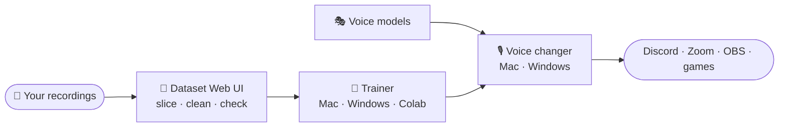

# Project Beatrice

**Free, open-source, real-time AI voice changing. On your own computer.** 
Change your voice live in Discord, Zoom, OBS and games, then train a voice of your own.

 

## ✨ What you get

- 🎙️ **Live voice changing, about 10 ms.** The Beatrice 2.0 neural engine runs on your machine. No cloud, no account, no subscription.
- 📦 **Download and go.** The Mac and Windows apps have everything inside, and set up the virtual microphone for you on first launch.
- 🎭 **112 voices built in.** Import more, or train your own from a few minutes of recordings.
- 🔊 **Soundboard and library.** 100+ meme and effect sounds with artwork, playable straight into your call.
- 🆓 **Open source.** MIT-licensed apps, made in the open.

## 🧭 Start here

| I want to… | Go to |
|:--|:--|
| **Change my voice on a Mac** (Apple Silicon) | [**Beatrice for Mac**](https://github.com/satiricalguru/Beatrice-voicechanger-mac) · [mirror](https://github.com/Project-Beatrice-V2/Beatrice-voicechanger-macos) |
| **Change my voice on Windows** 10/11 | [**Beatrice for Windows**](https://github.com/satiricalguru/Beatrice-voicechanger-windows) · [mirror](https://github.com/Project-Beatrice-V2/Beatrice-voicechanger-windows) |
| **Get more voices** | [Beatrice-voice-models](https://github.com/Project-Beatrice-V2/Beatrice-voice-models) |
| **Train my own voice** | [Trainer for Mac](https://github.com/Project-Beatrice-V2/Beatrice-trainer-macos) · [Trainer for Windows](https://github.com/Project-Beatrice-V2/Beatrice-trainer-windows) · [Colab & Kaggle](https://github.com/Project-Beatrice-V2/Beatrice-colab) |
| **Prepare recordings for training** | [Dataset Web UI for Mac](https://github.com/Project-Beatrice-V2/Beatrice-dataset-webui-macos) · [for Windows](https://github.com/Project-Beatrice-V2/Beatrice-dataset-webui-windows) |
| **Read guides, hear samples** | [project-beatrice.vercel.app](https://project-beatrice.vercel.app) · [website source](https://github.com/Project-Beatrice-V2/Beatrice-website) |

## 🛠️ From recordings to a live voice

<b>1 · Prepare a dataset</b>

 

Open the Dataset Web UI ([Mac](https://github.com/Project-Beatrice-V2/Beatrice-dataset-webui-macos) / [Windows](https://github.com/Project-Beatrice-V2/Beatrice-dataset-webui-windows)), load your recordings, and it slices them into clean clips and exports a ready-to-train dataset.

<b>2 · Train a model</b>

 

Train locally with the trainer for [Mac](https://github.com/Project-Beatrice-V2/Beatrice-trainer-macos) (Apple Silicon) or [Windows](https://github.com/Project-Beatrice-V2/Beatrice-trainer-windows) (NVIDIA CUDA), or on a free cloud GPU with the [Colab & Kaggle notebooks](https://github.com/Project-Beatrice-V2/Beatrice-colab).

<b>3 · Use it live</b>

 

In the voice changer, choose **Upload Custom Model** and pick your model's ZIP. Press the power button, pick the voice, and select the virtual microphone (BlackHole on Mac, VB-CABLE on Windows) in your call app.

 

  

Built on the <a href="https://github.com/prj-beatrice/beatrice-vst">Beatrice engine</a> by prj-beatrice · Apps released under the MIT License · ⭐ Star a repo if Beatrice made you laugh

